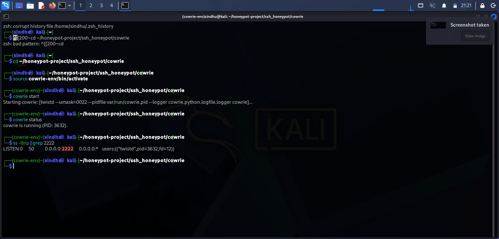
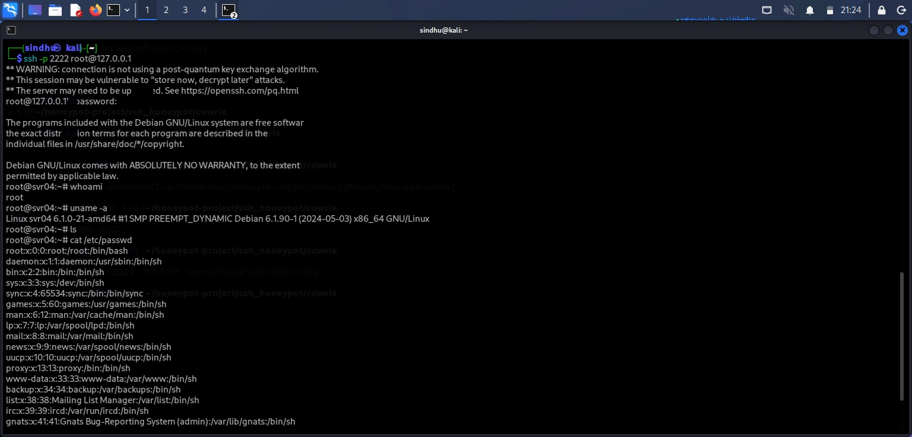
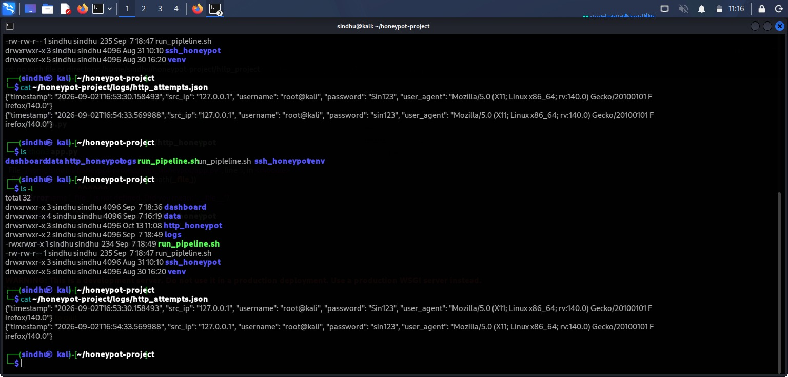
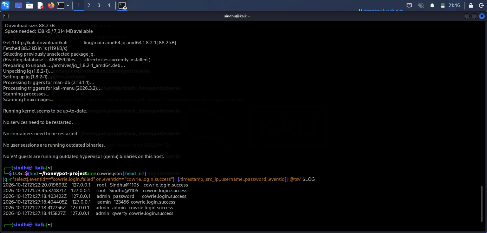
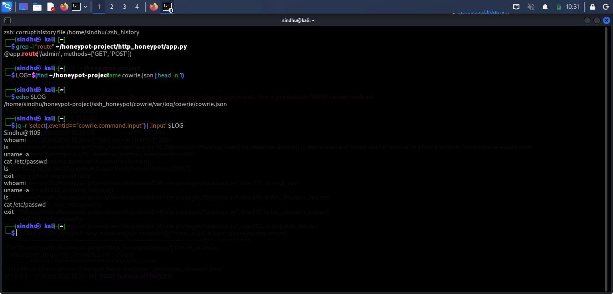
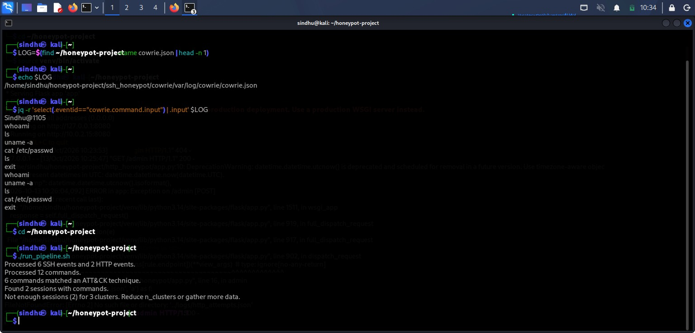

# Multi-Service Adaptive Honeypot with Threat Intelligence Enrichment

A multi-service honeypot system that captures attacker behavior on simulated SSH and HTTP admin login services, enriches the captured data with GeoIP and reputation intelligence, maps observed commands to MITRE ATT&CK techniques, clusters attacker sessions, and visualizes findings on a live dashboard — fully automated end to end.

## Overview
This project simulates two commonly attacked services and observes what real or automated attackers do when they interact with them:

**SSH honeypot** (Cowrie) — emulates a full SSH shell, logs every login attempt and every command an attacker runs after logging in.
**HTTP honeypot** (Flask) — a fake `/admin` login page that captures submitted credentials, source IP, and user-agent.

Captured activity is then enriched, classified, clustered, and visualized to turn raw log noise into readable threat intelligence.

## Architecture
                 ┌──────────────────┐
  Attacker ───▶  │  SSH Honeypot    │ (Cowrie, port 2222)
                 │  HTTP Honeypot   │ (Flask, port 8080)
                 └────────┬─────────┘
                          │ raw logs (JSON)
                          ▼
                 ┌──────────────────┐
                 │  enrich.py       │  GeoIP (MaxMind) + AbuseIPDB
                 └────────┬─────────┘
                          ▼
                 ┌──────────────────┐
                 │ attack_mapping.py│  MITRE ATT&CK technique tagging
                 └────────┬─────────┘
                          ▼
                 ┌──────────────────┐
                 │cluster_sessions.py│ TF-IDF + KMeans session clustering
                 └────────┬─────────┘
                          ▼
                 ┌──────────────────┐
                 │  dashboard/app.py│  Flask + Chart.js live dashboard
                 └──────────────────┘

        run_pipeline.sh ties enrich → attack_mapping → cluster
        together, scheduled hourly via cron.

## Features

**SSH honeypot (Cowrie)** — emulated shell, JSON logging of logins and post-login commands.
**HTTP honeypot (Flask)** — fake admin login page capturing credentials, source IP, and user-agent to JSON.
**Enrichment** — GeoIP lookups via MaxMind GeoLite2-City and IP reputation via the AbuseIPDB API.
**MITRE ATT&CK mapping** — keyword-based rules tag captured commands with ATT&CK technique IDs (e.g. uname -a→ T1082, System Information Discovery).
**Session clustering** — TF-IDF + KMeans groups attacker sessions by command similarity to surface behavior patterns.
**Live dashboard** — Flask + Chart.js visualization of attack volume, top source countries, and more.
**Automation** — a single pipeline script runs the full enrichment → mapping → clustering sequence, scheduled hourly via cron.

## Tech Stack
Python 3
[Cowrie](https://github.com/cowrie/cowrie) — SSH/Telnet honeypot
Flask — HTTP honeypot + dashboard
Chart.js — dashboard visualization
scikit-learn — TF-IDF + KMeans clustering
MaxMind GeoLite2-City — IP geolocation
AbuseIPDB API — IP reputation scoring
jq — log inspection/querying
Bash + cron — pipeline automation

## Project Structure
ssh-http-honeypot/
├── ssh_honeypot/
│   └── cowrie/              # Cowrie SSH honeypot (own venv: cowrie-env)
├── http_honeypot/
│   ├── app.py                # Flask fake admin login page
│   └── templates/login.html
├── data/
│   ├── enrich.py              # GeoIP + AbuseIPDB enrichment (gitignored)
│   ├── enrich_example.py      # Safe template — no real API key
│   ├── attack_mapping.py      # MITRE ATT&CK technique tagging
│   └── cluster_sessions.py    # TF-IDF + KMeans clustering
├── dashboard/
│   ├── app.py                 # Dashboard Flask app (port 5000)
│   └── templates/dashboard.html
├── docs/screenshots/          # Evidence screenshots (see below)
├── run_pipeline.sh            # Runs enrich → attack_mapping → cluster
└── venv/                      # (gitignored)
## Setup

### 1. Clone and set up environment
bash
git clone https://github.com/Sindhuu-07/ssh-http-honeypot.git
cd ssh-http-honeypot
python3 -m venv venv
source venv/bin/activate
pip install -r requirements.txt

### 2. SSH honeypot (Cowrie)
bash
cd ssh_honeypot/cowrie
python3 -m venv cowrie-env
source cowrie-env/bin/activate
pip install -e .
cowrie start
cowrie status
Cowrie listens on port **2222**. Config templates live under `src/cowrie/data/etc/`.

### 3. HTTP honeypot
bash
cd http_honeypot
python3 app.py
Serves the fake admin login page on port **8080**.

### 4. Enrichment setup
Copy the example config and add your own credentials (never commit real keys):
bash
cp data/enrich_example.py data/enrich.py
# edit data/enrich.py and add your AbuseIPDB API key + path to GeoLite2-City.mmdb

### 5. Run the pipeline manually
bash
./run_pipeline.sh

### 6. Automate hourly (optional)
bash
crontab -e
# add:
0 * * * * /home/<user>/ssh-http-honeypot/run_pipeline.sh

### 7. Dashboard
bash
cd dashboard
python3 app.py

View at 'http://127.0.0.1:5000'.

## Screenshots

| Cowrie SSH honeypot running on port 2222 | SSH attacker session (whoami, uname -a, cat /etc/passwd) |

|  |  |

| Hydra brute-force recovering weak credentials | Cowrie login success/failure log query |
|---|---|
|  |  |

| Automated pipeline run (enrich → ATT&CK → cluster) | HTTP honeypot credential capture confirmed |
|---|---|
|  |  |

## Sample Findings
Captured credential-stuffing attempts against both the SSH and HTTP services, including common weak password guesses ('admin', password, 123456, qwerty).
Observed consistent post-login recon behavior on SSH: 'whoami', 'uname -a', 'ls', 'cat /etc/passwd' — mapped to MITRE ATT&CK **T1082 (System Information Discovery)** and related techniques.
Verified the full pipeline correctly parses and merges SSH and HTTP events, tags ATT&CK techniques, and flags when session volume is too low for meaningful clustering.

## Notes
This honeypot is for an isolated lab environment only (VirtualBox Kali Linux VM, NAT network). Do not expose it directly to the internet without proper isolation and monitoring.
 enrich.py, .env, logs, and venv/ are excluded from version control — see .gitignore.
Clustering requires a minimum number of sessions with commands to produce meaningful groups; low-traffic test runs may show "not enough sessions" — this is expected.

## Author

Sindhu — Cybersecurity student, VIT-AP University
GitHub: [Sindhuu-07](https://github.com/Sindhuu-07)
